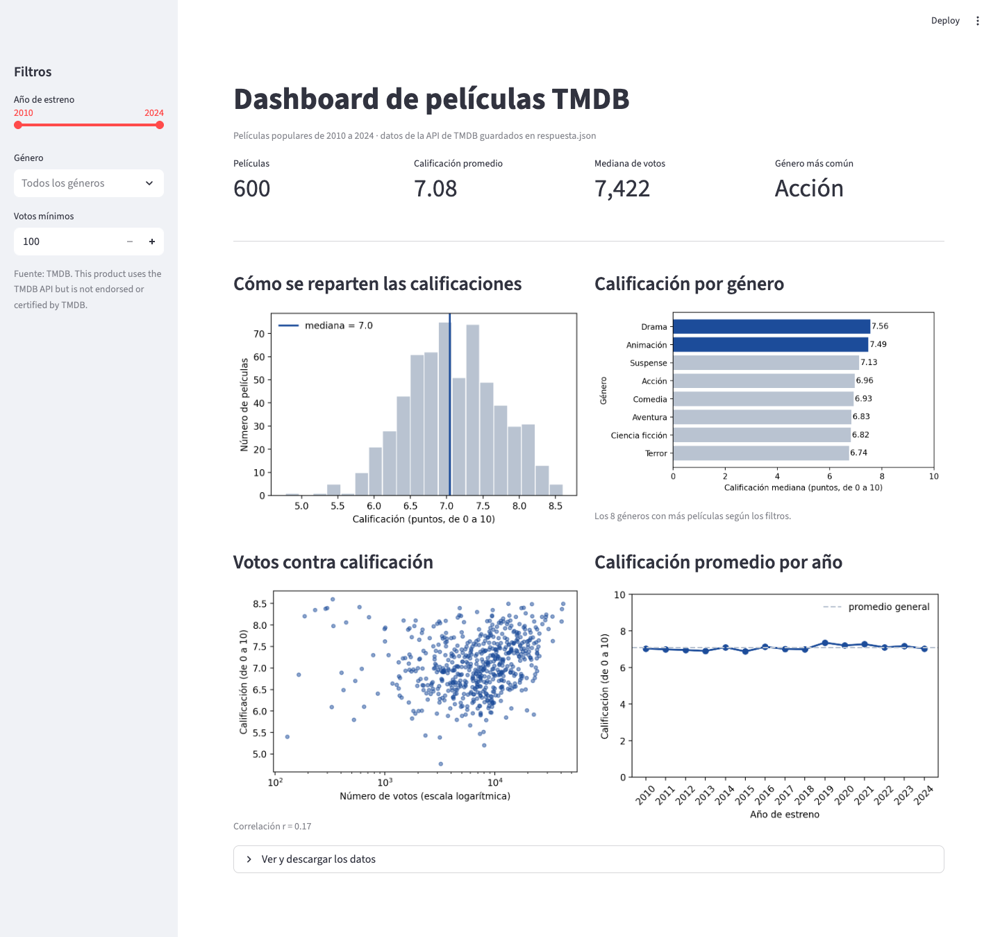
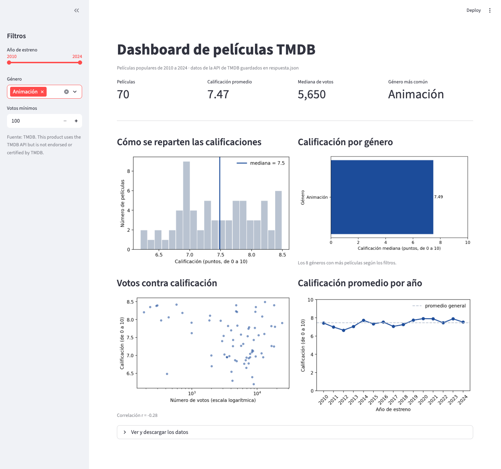
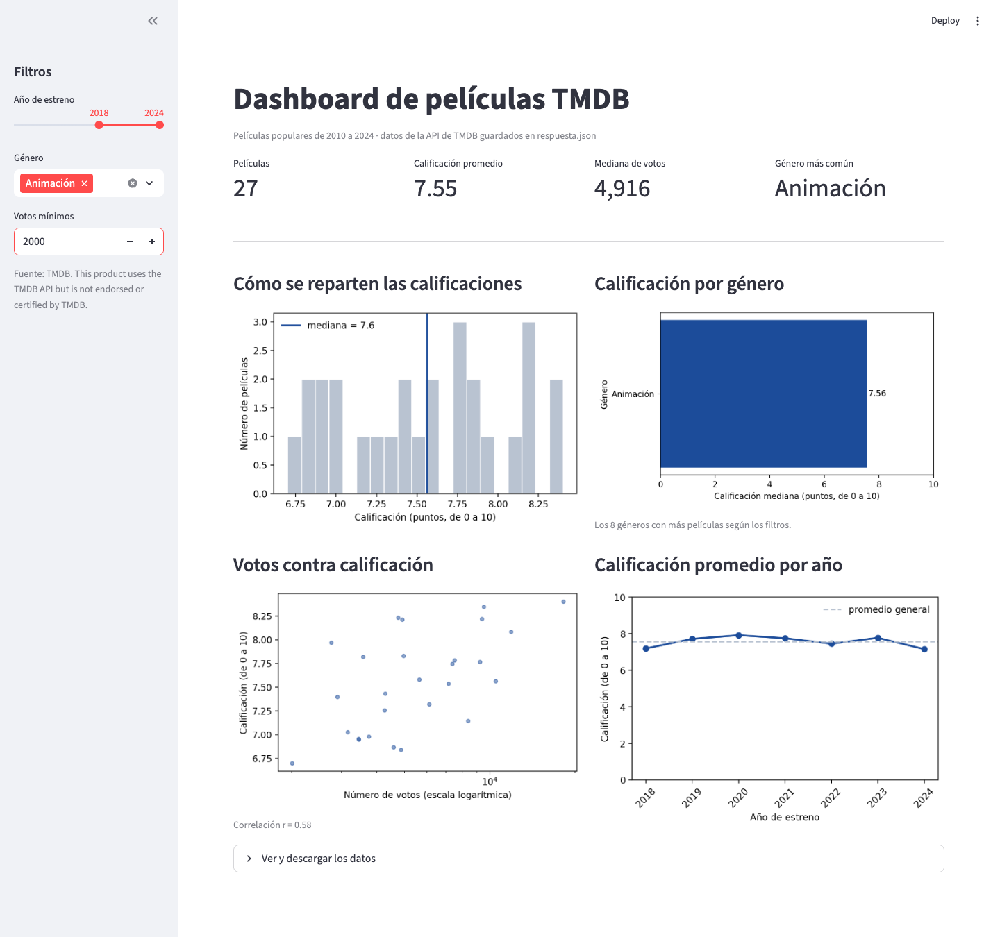
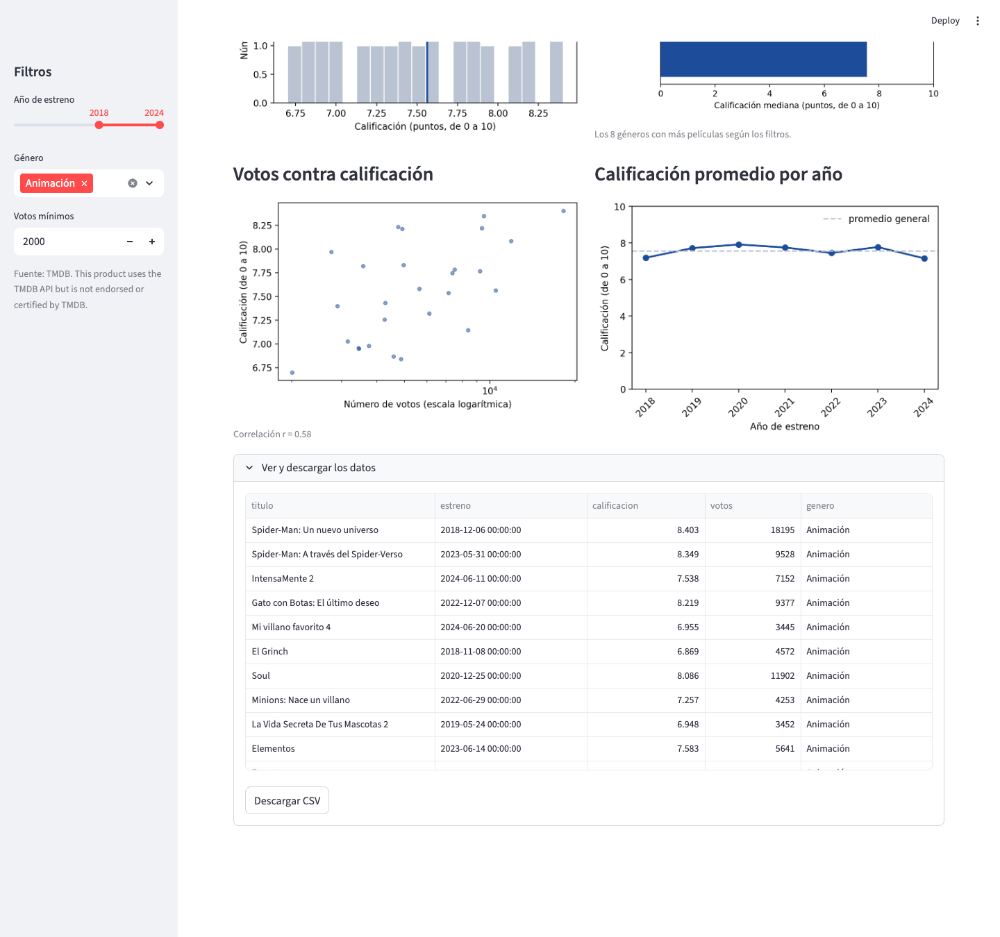

# Dashboard de películas TMDB

Dashboard hecho con Streamlit usando la API de mi evaluación (TMDB, The Movie Database).
Muestra 600 películas populares de 2010 a 2024 con al menos 100 votos.
Los datos no son en vivo: son la respuesta de la API guardada en `respuesta.json`.

## Qué tiene

- 4 indicadores
- 4 gráficas: distribución, comparación por género, relación votos-calificación y evolución por año
- Filtros de año, género y votos mínimos
- Tabla de datos y descarga en CSV

## Cómo correrlo

1. Instalar las librerías: `pip install -r requirements.txt`
2. Ejecutar: `streamlit run dashboard_tmdb.py`

Si se borra `respuesta.json`, el programa vuelve a consultar la API. Para eso se necesita
el archivo `.streamlit/secrets.toml` con `tmdb_token = "tu-token"`.
El token no está en el repositorio por seguridad.

## Evidencias

### Dashboard completo

### Filtro por género

### Filtro por año y votos

### Datos y descarga

Fuente: TMDB. This product uses the TMDB API but is not endorsed or certified by TMDB.
